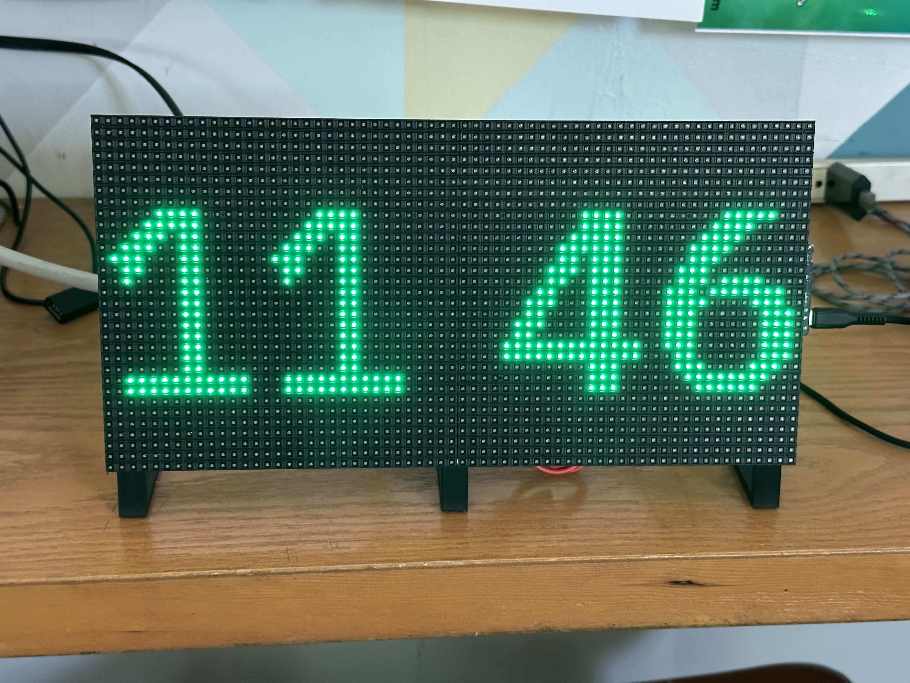
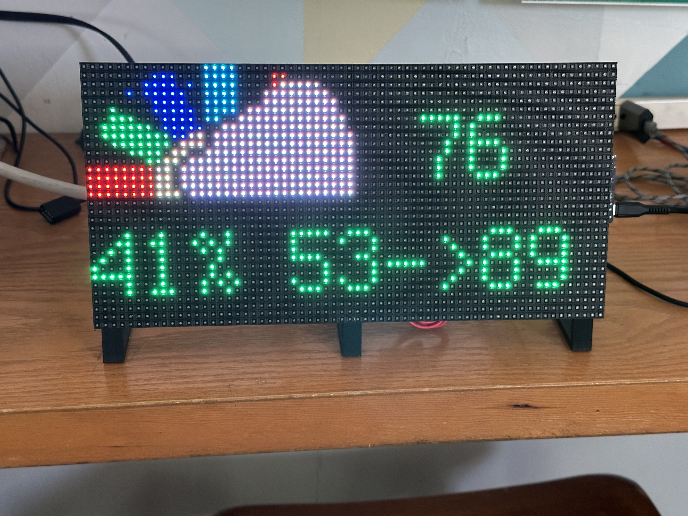
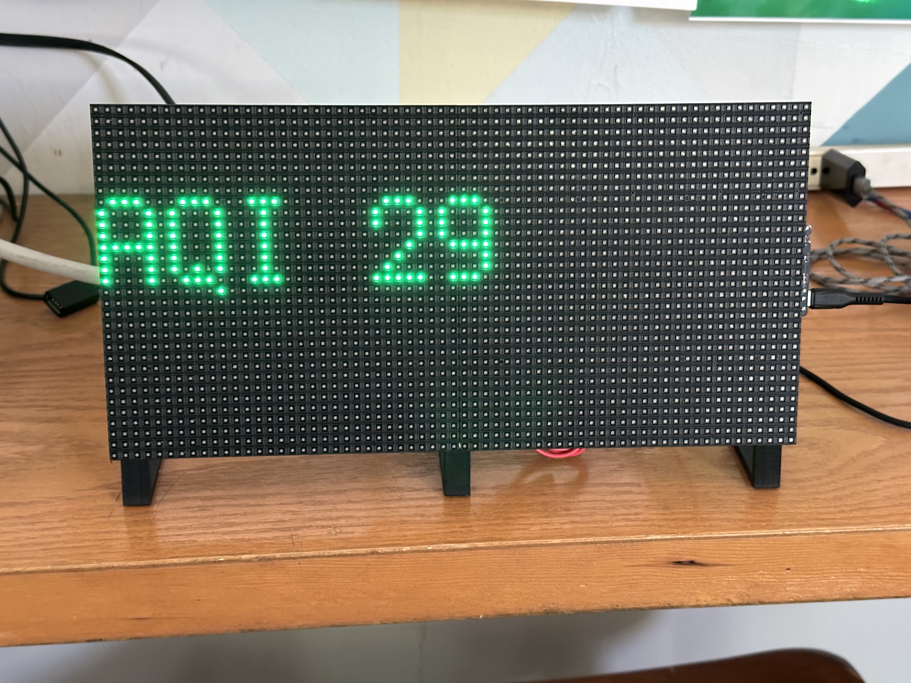
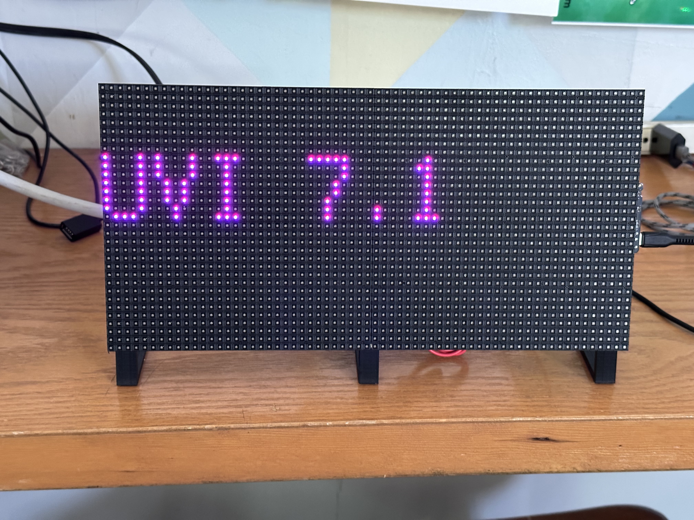

<!--
SPDX-FileCopyrightText: 2023-2026 John Romkey

SPDX-License-Identifier: MIT
-->

# Give Me A Sign!

[](https://github.com/romkey/give-me-a-sign/actions/workflows/build.yml)
[](https://github.com/psf/black)
[](https://give-me-a-sign.readthedocs.io/en/latest/?badge=latest)
[](https://opensource.org/licenses/MIT)
[](https://circuitpython.org/)
[](https://pypi.org/project/circuitpython-give-me-a-sign/)

Documentation: <https://give-me-a-sign.readthedocs.io/>

Give Me A Sign! is an info sign designed for hacker and makerspaces,
although you could use it in your home or office as well.

 
 

The sign will mostly look like a clock, while sometimes displaying
other useful information like messages, weather, air quality
information or whatever you push to it.

The sign is intended to be deployed and left aone. It doesn't pull
data (other than syncing its clock via NTP), data gets pushed to
it. The project includes examples of how to set up Home Assistant to
push data to the sign.

## Design Philosophy

In the age of connected devices one of the big questions becomes
"where should we do what?". For instance, should a smart sign that
shows the weather fetch the weather information itself, or would it be
better to push that information to it from a more capable computer?

Two important questions arise:

1. Is the device intended to be stand-alone, with no additional
   support? If so then obviously the complexity has to be in the
   device.
2. If the device is not intended to be stand-alone then where is the
   most appropriate place to put different functions?

Give Me A Sign! is not intended to run stand-alone. Its clock function
can but the biggest design decision here is to use an external source
(or sources) to push information to the sign rather than have it pull
information.

This allows much greater flexibility. For instance, PDX Hackerspace
has its own weather station. Rather than use weather conditions from a
weather service, we can use the ones that our weather station
reports. We still need weather forecasts, though, and we it's
convenient to pull the "current conditions" (like rain, snow,
volcanos, etc)  from an external source.

Pushing the data allows us to easily adapt to a mix of local and
remote sources and change that as we wish without having to update the
signs distributed around the space.

There are also questions about security. While it's difficult to
correctly protect secrets and sensitive information like passwords and
API keys on capable systems like Linux, it's even more difficult or
even impossible to protect them on embedded devices, especially
devices that people have physical access to. Not having them there at
all also means that you don't have to update certificates, change API
keys or keep other credentials up to date on devices where it's
inherently more difficult to do so.

## Hardware

This code targets boards with **native WiFi** and enough RAM for the full
application, such as the [Adafruit Matrix Portal
S3](https://www.adafruit.com/product/5778) connected to a 64x32 LED matrix.
The older Matrix Portal M4 (SAMD51 + AirLift ESP32 co-processor) is no longer
supported — there is not enough RAM to run the sign reliably.

Other native-WiFi matrix setups may work but have not been tested.

### Larger displays

Displays built from multiples of the standard 64x32 panel are supported:
chain panels for more width, stack ("tile") them for more height, or use
64-row panels (which need the ADDR E jumper closed and a board that
provides the fifth address line, like the MatrixPortal S3). Configure the
geometry in `settings.toml`:

```toml
MATRIX_WIDTH = 128         # total pixels across (chained panels)
MATRIX_PANEL_HEIGHT = 32   # rows per panel: 32, or 64 (needs ADDR E)
MATRIX_TILE = 2            # rows of panels stacked vertically
MATRIX_SERPENTINE = true   # alternate panel rows rotated 180 degrees
MATRIX_BIT_DEPTH = 2       # color depth; higher uses more RAM/CPU
```

Content is laid out on a virtual 64x32 canvas and integer-scaled to fit
the display, centered. Sizes that aren't proportional to 64x32 (say
128x32) scale by the common factor and letterbox the rest. Images pushed
to the `image` module via MQTT that are larger than 64x32 are shown unscaled at
the display's native resolution.

## Software

This project is written in CircuitPython. It depends on several
libraries that help manage the LED matrix, WiFi, the buttons, and the
RTC modules.

The application ships as a CircuitPython **library package** named
`give_me_a_sign` (import `GiveMeASign` from it). The package loads the
other modules, connects to MQTT, and drives the main display loop.
Fonts, splash images, and weather BMPs live in **`give_me_a_sign/assets/`**
(next to the `.py` files under `/lib/give_me_a_sign/` on the device).

Install the library on `CIRCUITPY` under `lib/give_me_a_sign/` using
[CircUp](https://learn.adafruit.com/keep-your-circuitpython-libraries-on-devices-up-to-date-with-circup/install-command)
(Adafruit’s recommended tool), for example from a clone of this repo:

```bash
circup install -r requirements.txt ./give_me_a_sign --py
```

CircUp reads `requirements.txt` for bundle library names and copies the
local `give_me_a_sign` package; use `--upgrade` if copies already exist on
the device. Bundle entries use **import names** (for example
`adafruit_minimqtt`, `adafruit_ntp`) as in
[the CircuitPython library bundle](https://circuitpython.org/libraries).

### Install from a GitHub release

Each release publishes **several** zip files. Pick the one that matches how you
want to install:

| Asset | Contents | Use when |
|-------|----------|----------|
| `give-me-a-sign-10.x-mpy-*.zip` | Precompiled `.mpy` under `lib/` | **Matrix Portal S3** and other **CircuitPython 10.x** boards (recommended) |
| `give-me-a-sign-9.x-mpy-*.zip` | Precompiled `.mpy` under `lib/` | CircuitPython 9.x boards |
| `give-me-a-sign-py-*.zip` | Source `.py` under `lib/` | Debugging or boards where you want readable source on device |
| `give-me-a-sign-examples-*.zip` | `examples/give-me-a-sign/code.py` and sample settings | Example app only (not the library) |

Do **not** use GitHub’s auto-generated **“Source code (zip)”** at the bottom of
the release page — that is the git tree (`.py` source), not the built library
bundle.

**Manual install (mpy):**

1. Download `give-me-a-sign-10.x-mpy-*.zip` from the
   [latest release](https://github.com/romkey/give-me-a-sign/releases).
2. Unzip and copy `lib/give_me_a_sign/` to `CIRCUITPY/lib/give_me_a_sign/`.
3. Copy `examples/give-me-a-sign/code.py` from the same zip (or from
   `give-me-a-sign-examples-*.zip`) to `CIRCUITPY/code.py`.
4. Install bundle dependencies with circup (they are not inside the release zip):

```bash
circup install -r requirements-circuitpython.txt --upgrade
```

**Install with circup (mpy release zip):**

```bash
unzip give-me-a-sign-10.x-mpy-0.5.2.zip
circup install -r requirements-circuitpython.txt \
  ./give-me-a-sign-10.x-mpy-0.5.2/lib/give_me_a_sign --upgrade
```

Circup copies the prebuilt `.mpy` package from the path you give it and pulls
Adafruit bundle libraries from the official bundles. Omit `--py` when using an
mpy release zip; `--py` forces source copies.

### Development vs release installs

For local development from a git clone, install the package as `.py` so code
remains readable on the device:

```bash
circup install -r requirements-circuitpython.txt ./give_me_a_sign --py --upgrade
```

On every push and pull request, Build CI runs `circuitpython-build-bundles` and
uploads a `bundles` artifact with the same zip names as GitHub releases.

### CircuitPython Community Bundle

This repo follows the
[CircuitPython Community Bundle](https://github.com/adafruit/CircuitPython_Community_Bundle)
library layout and CI (`circuitpython-build-tools`). To get into the bundle:

1. Land a SemVer-tagged GitHub Release (for example `0.5.2`) so release assets
   include stamped `.mpy` zips.
2. Fork `adafruit/CircuitPython_Community_Bundle`, add this repo as a submodule
   under `libraries/helpers/give_me_a_sign` (or another fitting category), and
   update `circuitpython_community_library_list.md`.
3. Open a PR against the Community Bundle. After merge, daily bundle releases
   pick up new tags from this repo automatically.

See Adafruit’s guide:
[Sharing in the Community Bundle](https://learn.adafruit.com/creating-and-sharing-a-circuitpython-library/sharing-in-the-community-bundle).

## Preparing The Sign

### Update CircuitPython

Install the latest CircuitPython for your board, for example:

https://circuitpython.org/board/adafruit_matrixportal_s3/

## Mounting

\#4-40 3/8" screws


## Installation

1. Install CircuitPython on the board and mount `CIRCUITPY`.
2. Install the library from a release (see **Install from a GitHub release**
   above) or, for development, from a clone:

```bash
circup install -r requirements-circuitpython.txt ./give_me_a_sign --py --upgrade
```

3. Copy `examples/code.py` to the root of `CIRCUITPY` (or merge into your own
   `code.py`), and add `settings.toml` / environment as needed.
4. Optionally copy `examples/config.json` to `/config.json` on `CIRCUITPY` to
   customize which modules rotate and for how long.

## Modules

Give Me A Sign uses a **module registry**. Each module:

- Declares the MQTT `ENDPOINTS` it listens to
- Owns a private data store (`ModuleStore`)
- Renders its own screens via `show()` / `loop()`
- May declare Home Assistant entities via `ha_entities()`
- May publish **complications** (fractional screen layouts) for composed screens

Built-in modules: `clock`, `weather`, `aqi`, `uv`, `pollen`, `greet`, `message`,
`image`, `tones`, `ota`, and store-only endpoints (`debug`, `lunar`).

### External modules

Copy a package named `gmas_*` into `CIRCUITPY/lib/` (for example
`lib/gmas_example/` from `examples/gmas_example/`). The package must export:

```python
MODULES = [YourModuleClass]
```

Each class subclasses `SignModule` from `give_me_a_sign.module`. You can also
list extra import names in `/config.json` under `"modules"`.

### Configuration (`/config.json`)

If `/config.json` is missing, the sign shows the default rotation:
clock (20s) → weather (10s) → aqi (10s) → uv (10s) → pollen (10s).

Example:

```json
{
  "modules": ["gmas_stocks"],
  "rotation": [
    {"module": "clock", "duration": 20},
    {"screen": {
      "name": "combo",
      "duration": 10,
      "complications": [
        {"ref": "clock.mini", "x": 32, "y": 0},
        {"ref": "aqi.eighth", "x": 0, "y": 0}
      ]
    }}
  ]
}
```

Complication refs use the form `module_name.complication_name`. Slot sizes on the
64×32 canvas: full (64×32), half-wide (64×16), half-tall (32×32), quarter
(32×16), eighth (32×8).

See `examples/config.json` for a full example.

## API

Data is pushed to the sign over **MQTT**, not HTTP. Each sign subscribes to
topics under `MQTT_TOPIC_PREFIX` (default `givemeasign`):

- `{prefix}/all/module/{endpoint}` — broadcast to every sign
- `{prefix}/sign/{mac}/module/{endpoint}` — per-device (used by Home Assistant)

Supported `{endpoint}` values include `weather`, `message`, `greet`, `aqi`, `uv`,
`pollen`, `forecast`, `lunar`, `tones`, `image`, `timezone`, `solar`, `trimet`,
and `debug`. Payloads are JSON objects (plain text is accepted for `message` and
`greet`).

Per-device command topics (under `{prefix}/sign/{mac}/`):

| Topic | Payload | Effect |
|-------|---------|--------|
| `reboot` | any | MCU reset |
| `display/set` | `ON` / `OFF` | Blank or show the matrix |
| `time/set` | ISO 8601 UTC, epoch, or `{"epoch": …}` | Set the device RTC |
| `data/publish` | any | Publish all module data stores to `data/state` |
| `module/ota_url` | URL text or `{"url": …}` | Set the firmware image URL |
| `module/ota_install` | `install`, or a URL | Download and install firmware |

Home Assistant autodiscovery is built in when MQTT is configured. See
`give_me_a_sign/home_assistant.py` for entity definitions.

## Displaying Images

Store the image as in indexed BMP format. Follow the code in nyan.py to display it. Can also load some GIFs and PNGs.

```
magick original.bmp -colors power-of-two output.bmp
```

Adafruit has [a good discussion of how to deal with indexed BMPs](https://learn.adafruit.com/creating-your-first-tilemap-game-with-circuitpython/indexed-bmp-graphics).

## Working with fonts

adafruit_bitmap_font.py

https://github.com/adafruit/Adafruit_CircuitPython_Bitmap_Font

## Weather Icons

## Home Assistant

Configure MQTT in `settings.toml` and set `SIGN_NAME` if you want a friendly
device name in Home Assistant. The sign publishes MQTT autodiscovery configs
for text entities, a display switch, a device-time datetime, reboot,
publish-data and firmware-install buttons, and diagnostic sensors (including
the firmware update status — see **Over-the-air firmware updates** below).

Example — publish a message via MQTT (mosquitto_pub):

```
mosquitto_pub -h broker -t 'givemeasign/all/module/message' \
  -m '{"text": "Hello!", "color": 16711680}'
```

Set the clock (ISO 8601 UTC, as Home Assistant's datetime entity sends):

```
mosquitto_pub -h broker -t 'givemeasign/sign/aa_bb_cc_dd_ee_ff/time/set' \
  -m '2026-07-10T12:00:00+00:00'
```

Dump the in-memory Data store (also available as the **Publish Data Store**
button in Home Assistant):

```
mosquitto_pub -h broker -t 'givemeasign/sign/aa_bb_cc_dd_ee_ff/data/publish' \
  -m publish
# then: mosquitto_sub -h broker -t 'givemeasign/sign/aa_bb_cc_dd_ee_ff/data/state' -C 1
```

## Over-the-air firmware updates

The `ota` module installs a new CircuitPython build over WiFi using the ESP32
[`dualbank`](https://docs.circuitpython.org/en/latest/shared-bindings/dualbank/index.html)
module, which writes the inactive half of a dual-OTA flash layout and then
boots into it.

Set the image URL, then press the button:

```
mosquitto_pub -h broker -t 'givemeasign/sign/aa_bb_cc_dd_ee_ff/module/ota_url' \
  -m 'https://example.com/adafruit-circuitpython-matrixportal_s3-en_US-10.0.0.bin'
mosquitto_pub -h broker -t 'givemeasign/sign/aa_bb_cc_dd_ee_ff/module/ota_install' \
  -m install
```

`ota_install` also accepts a URL directly, which sets and installs in one
step — handy as a one-shot that skips the URL entity entirely.

In Home Assistant the module advertises five entities:

| Entity | Type | Purpose |
|--------|------|---------|
| **Firmware** | update | Native install button with progress, installed vs. latest version |
| **Firmware URL** | text | The `.bin` or `.uf2` to fetch (device page, Configuration) |
| **Firmware URL (controls)** | text | The same thing, in the main controls |
| **Install Firmware** | button | Start the download and flash |
| **Firmware Update Status** | sensor | `idle`, `downloading 42%`, `rebooting in 3s`, `failed: …` |

**Why two URL fields.** A text entity only publishes when its value is
committed, and some browsers do not commit the field rendered in the device
page's **Configuration** block. **Firmware URL (controls)** is deliberately
shaped exactly like the Message entity — no `entity_category`, so it lands in
the main controls, and no `state_topic`, so Home Assistant is optimistic and
keeps what was typed rather than waiting for the sign to echo it back. If the
configuration field will not commit in your browser, use this one. Either may
supply the URL; the configuration field wins when both hold one.

The **Firmware** update entity needs no text field at all: it offers Install
whenever the URL names a version different from the running build, and
reports progress through Home Assistant's own update UI.

In Home Assistant the module advertises three entities:

| Entity | Type | Purpose |
|--------|------|---------|
| **Firmware URL** | text | The `.bin` or `.uf2` to fetch |
| **Install Firmware** | button | Start the download and flash |
| **Firmware Update Status** | sensor | `idle`, `downloading 42%`, `rebooting in 3s`, `failed: …` |

The status sensor also carries JSON attributes (`state`, `progress`,
`bytes_received`, `bytes_total`, `format`, `url`, `error`), published to
`{prefix}/sign/{mac}/ota/attributes`.

How it works:

- The download runs a few KiB per pass of the main loop, so the display keeps
  drawing and MQTT keeps flowing while the image comes down. Progress appears
  on the matrix and in Home Assistant.
- An update in progress holds the matrix, but yields to anything with a turn
  of its own — a message or greeting that arrives mid-download gets its full
  duration, and the buttons still bring up the IP and splash screens. The
  download carries on underneath regardless of what is on screen.
- `.uf2` input is unwrapped as it streams: each 512-byte UF2 block's 32-byte
  header and trailing magic are dropped and only the payload is flashed, in
  target-address order. Raw `.bin` input is flashed as-is.
- Writes are buffered into 4 KiB blocks to satisfy the ESP-IDF OTA writer.
- When the image is fully written the sign calls `dualbank.switch()`, counts
  down **5 seconds** on the display and on MQTT, and then resets into the new
  firmware.
- Anything that goes wrong — a bad URL, an HTTP error, a truncated or
  implausibly small image, a UF2 with bad magic — leaves the current firmware
  untouched and reports `failed: …` on the status sensor.

### Troubleshooting an update that does nothing

On the serial console the sign reports each step. At MQTT connect it prints
the topics it actually listens to:

```
MQTT base topic: givemeasign/sign/aa_bb_cc_dd_ee_ff
MQTT module endpoints: aqi, greet, image, message, ota_install, ota_url, ...
```

If `ota_install` and `ota_url` are missing from that list, the running build
does not have the OTA module — and the Home Assistant entities prove nothing
either way, because discovery configs are published **retained**, so they
survive in the broker (and in Home Assistant) long after the build that
published them is gone.

Then, when a payload arrives, every endpoint prints a receive line before any
module logic runs:

```
mqtt:rx module/ota_install (7 bytes)
ota: ota_install <- 'install'
ota: install requested, using stored url 'https://example.com/firmware.bin'
ota: downloading - downloading 0%
ota: downloading - downloading 14%
ota: countdown - rebooting in 5s
```

To isolate the sign from Home Assistant, publish straight to it — this is the
same thing the button does:

```bash
SIGN=givemeasign/sign/aa_bb_cc_dd_ee_ff
mosquitto_pub -h $BROKER -t $SIGN/module/ota_install -m 'https://example.com/firmware.bin'
```

| What you see | What it means |
|---|---|
| No `mqtt:rx` line | The payload never reached the sign: wrong base topic (check `MQTT_TOPIC_PREFIX` and the MAC), broker ACLs, or this build doesn't subscribe to the endpoint |
| `mqtt:rx` but no `ota:` line | The endpoint is claimed by a different module — check the endpoint list for a collision |
| `ota: … failed: …` | The update was attempted; the reason is on the line and on the status sensor |
| `mqtt:rx module/ota_install` but never `module/ota_url` | The URL never left Home Assistant: the field was not committed. Try **Firmware URL (controls)**, or publish the URL to `module/ota_install` directly |
| `failed: no HTTP session: no module named 'adafruit_requests'` | `adafruit_requests` and `adafruit_connection_manager` are not in `/lib`: `circup install adafruit_requests adafruit_connection_manager` |
| `failed: no HTTP session: wifi is not connected` | The radio was down when the download started; the sign retries nothing by itself, so press Install again once WiFi is back |
| `failed: platform cannot make HTTP requests - stale give_me_a_sign install?` | `ota.py` is newer than `platform.py` on the board — copy the whole `give_me_a_sign` package, not just the new file |

Watch the status from the broker side with
`mosquitto_sub -h $BROKER -v -t "$SIGN/ota/#"`.

**Use an application image, not a combined one.** `dualbank` writes a single
OTA app partition, so the file must contain just the CircuitPython
application — the `.bin` from a CircuitPython release, not a `-combined.bin`
or a factory image that also carries a bootloader and partition table at
absolute flash offsets. A `.uf2` works only when it holds an app-only image;
the board must also be running a build whose partition table has two OTA
slots.

## Timezones
